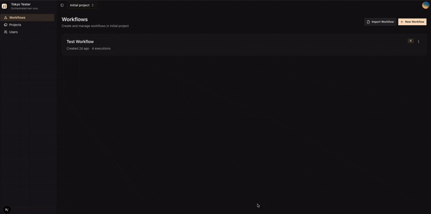

# Tokyo Tester

Tokyo Tester is a local-first end-to-end testing tool for service graphs and the infra they depend on.

You build workflows in the UI, run them through the Go runner, and keep workflow definitions, executions, logs, and test results synced back into the app.

If you want a higher-level walkthrough of how the pieces fit together, see [How the system works](./docs/system-overview.md).

## Preview



## Try The Sample Workflow

If you want to get a feel for the product quickly, import [`test-workflow.json`](./test-workflow.json) into the UI.

Before importing it, build the sample API image the workflow expects:

```bash
docker build -t bun-user-api:latest ./test-api
```

In the workflow list, use **Import Workflow**, then select the file. It gives you a ready-made example with:

- a service graph
- a PostgreSQL dependency
- HTTP and database tests
- scenarios that show how runs are organized

For a substantially deeper exercise, build the fixture image with `make test-api-build` and
import [`test-payment-platform.json`](./test-payment-platform.json). It covers every supported
provider and test executor through an asynchronous payment-settlement flow. The companion
[`test-payment-resilience.json`](./test-payment-resilience.json) deliberately finishes with
partial failures so logs, continuation, provisioning errors, and cleanup can be inspected.
The full matrix is intentionally opt-in through `make test-complex-e2e` because it can use
4–6 GB of Docker memory and requires several large image downloads.

## What It Does

- Build workflow graphs in the UI
- Provision services and dependencies through the runner
- Execute tests against the running stack
- Track workflow runs, logs, and results
- Persist workflow definitions locally first, then sync them to the backend
- Recover execution state from the backend when realtime delivery misses a beat

## How It Works

- `ui-v2` is the Next.js app for editing workflows, scenarios, and executions
- `runner-v2` is the Go service that provisions containers, runs tests, and cleans up
- the separately deployed `mcp` process exposes agent-safe tools and has no Docker socket or database access
- Caddy routes public `/mcp` traffic to that process while keeping the runner private
- `docker-compose.yml` wires the UI and runner to separate schemas on the same MySQL server; PostgreSQL remains available for explicitly configured non-worker installations
- the frontend sync layer persists queued edits locally, flushes them to `POST /api/v1/sync/batch`, and hydrates from `GET /api/v1/sync/pull/{clientId}`
- the runner's embedded durable worker coordinates execution, persists checkpoints, and streams replayable SSE updates to the UI from MySQL
- when workflow execution or cleanup is enabled, the runner validates Docker reachability during startup and fails before serving if the daemon or socket is unavailable

## Production Notes

Follow the complete [Production deployment runbook](./docs/production-deployment.md) before exposing Tokyo Tester to a network. It covers DNS/TLS, secrets, migrations, verification, agent access, backups, upgrades, rollback, and incident commands.

The supported production deployment for this release is a dedicated Linux Docker host. Kubernetes execution, environment profiles, and the previous Docker-in-Docker profile are parked until a native in-cluster backend passes the same execution, cleanup, recovery, and persistence gates as Docker.

- `make prod-check` validates the host, secrets, socket access, Compose definition, and writable volumes
- `make prod` builds the standalone UI image, migrates both databases, starts the single-server stack, and waits for readiness
- `make prod-verify` checks public/private health, runs a minimal Docker workflow, and checks for leaked managed resources
- `make prod-backup` creates one checksummed, transactionally consistent dump of both MySQL databases
- MySQL is the supported default for the runner and UI; workflow MySQL service nodes are separate from this app database setting
- production startup detects the host Docker socket before Compose starts, then the runner checks Docker again from inside the container; a bad socket now fails startup instead of waiting until a workflow is run
- the UI keeps Bun for installation, development, builds, and tests; the standalone production server follows Next.js's Node entrypoint, and migrations use the native MySQL path
- workflow definitions are synced from the browser, while execution-owned records like workflow runs, scenario runs, and test results are treated as backend-owned during execution
- if you have an old UI image cached, rebuild the service before retesting production behavior:

```bash
docker compose build --no-cache ui
```

## Getting Started

The easiest way to run everything locally is with Docker:

```bash
make dev
```

That checks the machine, starts the UI and runner, and applies pending UI and runner migrations. A database reset is not required for a normal update.

`make dev` chooses the startup mode from the detected Docker socket:

- standard `/var/run/docker.sock`: UI and runner run in Docker Compose
- non-standard sockets such as Colima or Rancher Desktop: UI runs in Docker and the Go runner runs on the host with `TESTCONTAINERS_RYUK_DISABLED=true`

If Dockerized UI mounts or local socket routing misbehave on a development machine, use:

```bash
make dev-local
```

That runs both the UI and runner on the host while still applying the same migrations and Docker checks.

Useful commands:

```bash
make prod
make dev-local
make check
make down
make reset # also deletes local database volumes
```

For a second-PC development setup with a coding agent and several local repositories, follow [Development setup with a coding agent](./docs/development-agent-setup.md).

If you want to run pieces manually, the main environment values live in [`.env.example`](./.env.example).

Common ports:

- UI: `http://localhost:3000`
- Runner API when using the host-runner development fallback: `http://localhost:8080`
- Local MCP adapter: `http://localhost:8090/mcp`

## AI Agent Integration

For local development, run `make dev`, then run `make agent-dev` in another terminal. Connect the coding agent to `http://localhost:8090/mcp` with a project-scoped token. The in-app **Docs** page walks through token creation, skill installation, and a practical multi-repository test.

The production Compose stack exposes a remote MCP endpoint at `https://<TOKYO_TESTER_DOMAIN>/mcp`. The MCP process forwards project-scoped operations to the authenticated UI/API and never receives filesystem or Docker access.

The current authentication path is an explicitly private-beta personal token. While signed in, create one with `POST /api/v1/agent/tokens`:

```json
{
  "name": "My coding agent",
  "projectId": "<project-id>",
  "scopes": ["read", "workflow:write", "run"],
  "expiresInDays": 30
}
```

The raw `tt_pat_...` token is returned once. Configure the MCP client to send it as `Authorization: Bearer <token>`. Use the repository skill at [`.agents/skills/tokyo-tester`](./.agents/skills/tokyo-tester) to guide repository inspection, workflow authoring, validation, execution, and repair.

Revoke a token with `DELETE /api/v1/agent/tokens/<token-id>` from an authenticated session.

Before opening MCP registration broadly, replace private-beta tokens with an OAuth 2.1 authorization server and MCP protected-resource discovery. The MCP adapter is intentionally isolated so that authentication transport can change without touching workflow execution.

## Built With

- Next.js
- React
- Zustand
- MySQL durable worker
- Go
- Chi
- Docker
- testcontainers-go

## Notes

- The project is still local/self-hosted by default.
- You do not need a deployed demo to explore the code or understand the workflow.
